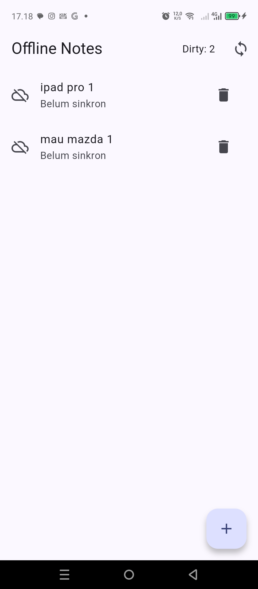
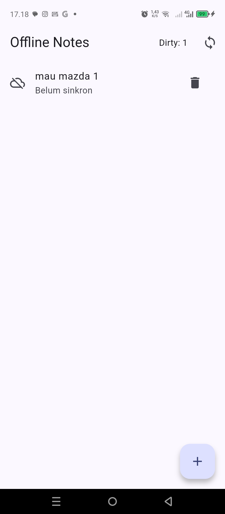
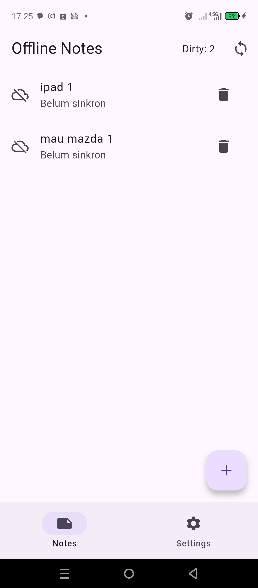
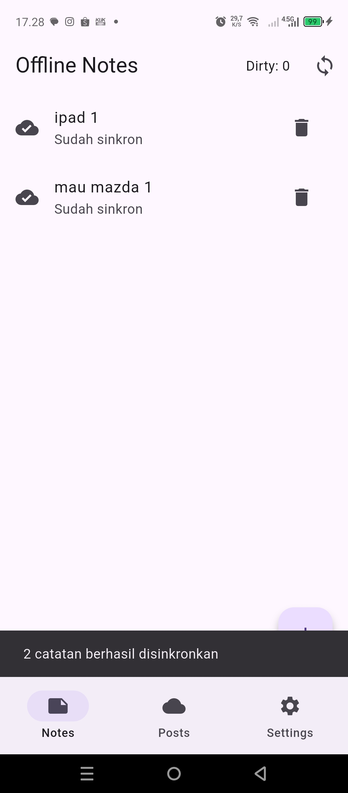
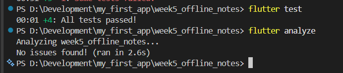

# Offline Notes App — Local Storage & Offline First (Week 5)

## Tujuan
Menerapkan penyimpanan lokal dan konsep **offline-first** pada Flutter menggunakan **SharedPreferences**, **SQLite (sqflite)**, **Riverpod**, dan cache API.

## Fitur
- CRUD catatan lokal dengan SQLite.
- Catatan baru memiliki `dirty = true`.
- Sinkronisasi catatan dengan `syncNotes()`.
- Mode **Force Offline** untuk simulasi tanpa internet.
- Cache-first untuk data `GET /posts` JSONPlaceholder.
- `NoteTile` sebagai widget terpisah.
- Unit test memakai `FakeNoteRepository`.

## Teknologi
- Flutter
- `flutter_riverpod`
- `shared_preferences`
- `sqflite`
- `dio`
- `go_router`

## Cara Menjalankan
```bash
flutter pub get
flutter run
```

Verifikasi:
```bash
flutter analyze
flutter test
```

## Hasil

### Offline Notes


### Dirty / belum tersinkron


### Proses sinkronisasi


### Setelah sinkronisasi


### Analyze & Test


```text
No issues found!
All tests passed!
```

## Perbandingan Penyimpanan

| Teknologi | Kelebihan | Kekurangan | Penggunaan |
|---|---|---|---|
| SharedPreferences | Sederhana, ringan | Tidak cocok untuk koleksi/query | Preferensi tema |
| Hive | Ringkas, cepat | Relasi/query terbatas | Object lokal sederhana |
| sqflite | SQL fleksibel, cocok CRUD | Mapping manual | **Catatan** |
| Drift | Type-safe, reactive stream | Setup lebih banyak | App lebih kompleks |

## Keputusan
**SharedPreferences** dipilih untuk preferensi karena cocok untuk key-value sederhana.

**SQLite/sqflite** dipilih untuk catatan karena mendukung CRUD, query, `dirty`, `updated_at`, dan sinkronisasi offline.

## AI Verification
- Catatan tidak disimpan di SharedPreferences.
- Skema memakai `dirty` dan `updated_at` untuk mendukung sinkronisasi.
- sqflite tidak otomatis real-time; UI diperbarui melalui provider.
- Drift lebih reactive dan type-safe, tetapi boilerplate lebih besar.
- Repository diuji menggunakan `FakeNoteRepository` tanpa SQLite sungguhan.

## Refleksi
SharedPreferences cukup untuk data sederhana seperti tema, sedangkan SQLite lebih cocok untuk koleksi catatan. `dirty` dipakai untuk menandai data yang belum tersinkron. Cache-first membuat data tetap bisa ditampilkan saat offline. Logika cache dan sinkronisasi dipisahkan ke `sync.dart` agar repository tetap fokus pada CRUD.
